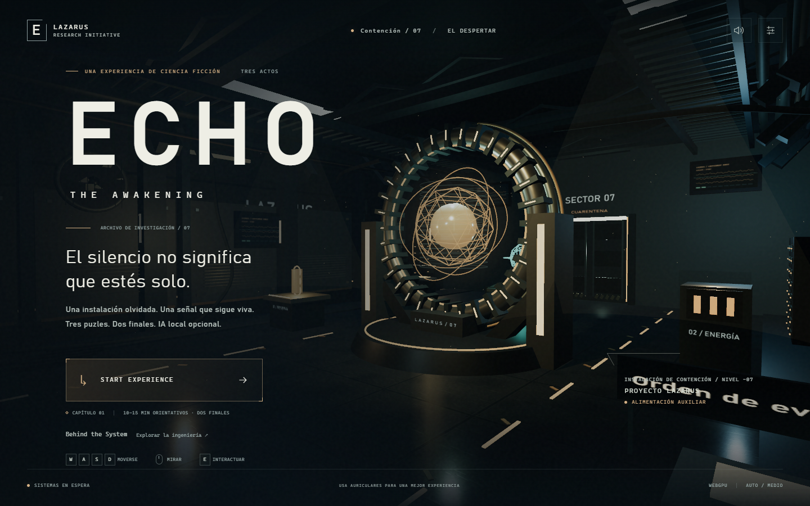
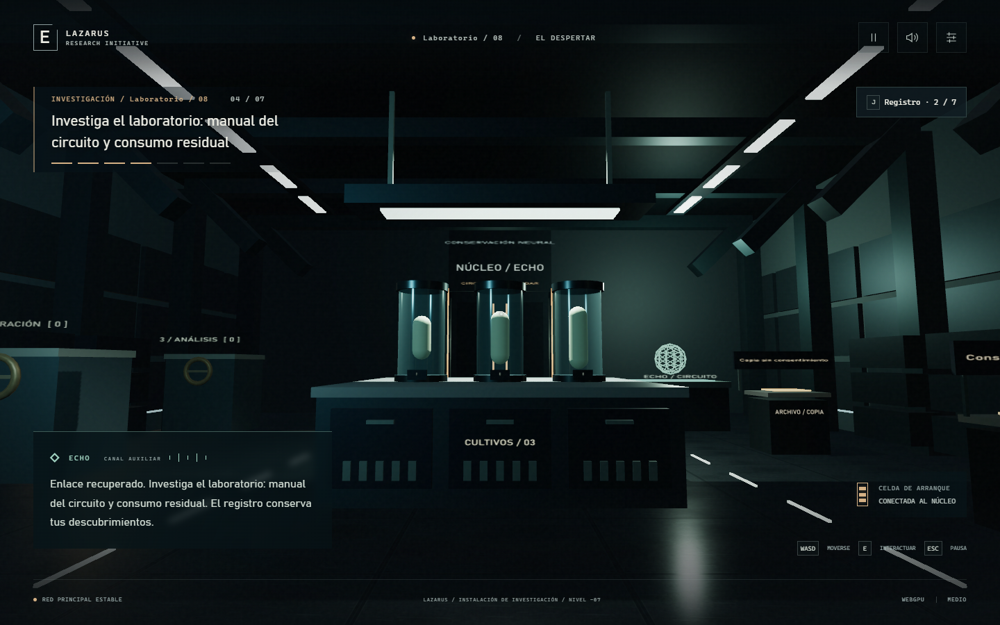
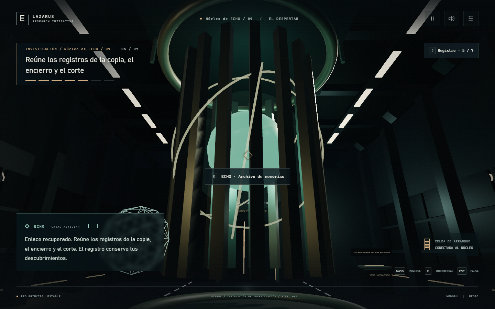
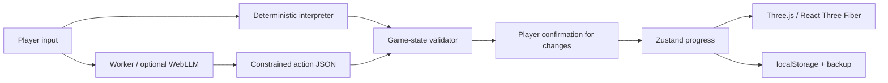

# ECHO: THE AWAKENING

[](https://github.com/AVL05/echo-the-awakening/actions/workflows/ci.yml)

A first-person science-fiction experience built for the browser. Explore an abandoned research facility, investigate what happened, and decide what its resident AI is allowed to preserve.

**[Play the demo](https://echo-the-awakening.pages.dev/) · [Behind the System](https://echo-the-awakening.pages.dev/behind-the-system)**

Three connected zones, three puzzles, seven discoverable records and two endings. The entire chapter works without a language model. Optional on-device inference gives ECHO another way to interpret your instructions and propose actual game actions.

Current in-game language: **Spanish**. Desktop and touch controls are included. The 10–15 minute playtime is a design target, not a measured average from player research.



## Experience

- Recover power, balance a conservation circuit and reconstruct the incident chronology.
- Investigate documents, request optional hints, and choose between preserving the archive or erasing it and isolating ECHO.
- Use physical controls, deterministic terminal commands or an optional local language model. No puzzle depends exclusively on unpredictable model output.
- Inspect real events and runtime measurements in **Behind the System**: interpretation, validation, confirmation, execution and persistence. No model reasoning is exposed.

| Research laboratory | ECHO's core |
| --- | --- |
|  |  |

Original, unretouched browser captures: WebGPU, medium profile, DPR 1. These selected documentation images are deliberately public; automated captures and local audit reports are excluded from Git.

## Technology

| Area | Implementation |
| --- | --- |
| Application | React 19, TypeScript, Vite |
| Graphics | Three.js r186, React Three Fiber 9.8; WebGPU with WebGL 2 fallback |
| Materials | Procedural PBR maps, TSL energy, fog, particles and approximate reflections |
| Gameplay | Zustand, deterministic puzzle rules, raycasting, custom movement/collision |
| Audio | Web Audio synthesis, without downloaded recordings |
| Local AI | WebLLM 0.2.86 and a dedicated Web Worker |
| Delivery | Static Cloudflare Pages assets; no application backend |

## Run locally

Use **Node.js 24** (see [.node-version](.node-version)) and npm.

```sh
git clone https://github.com/AVL05/echo-the-awakening.git
cd echo-the-awakening
npm ci
npm run dev
```

Open the URL printed by Vite, normally `http://127.0.0.1:5173/`. WebGPU and local inference require HTTPS or localhost and hardware acceleration. Do not open `index.html` through `file://`.

```sh
npm run typecheck
npm run lint
npm test
npm run build
npm run check:release
npm run preview
```

Production preview normally runs at `http://127.0.0.1:4173/`. The build also runs lint and tests before generating license notices and compiling, so native Pages builds have the same quality gates as CI. `private: true` in package.json prevents accidental npm publication; this GitHub repository is public.

## Controls and recovery

**WASD** moves, the **mouse** looks, **E** interacts, **J** opens discoveries and **Esc** pauses. Arrow keys provide keyboard movement/turning. Settings offer drag-to-look instead of pointer capture. On touch devices, use the directional pad while dragging the scene with another finger.

Actions save progress to localStorage with a previous-revision backup. Continuing places you at a safe zone checkpoint, rather than your exact former position. Corrupt saves are repaired or recovered from backup. If storage is unavailable, the game remains playable for that session and warns that progress cannot be saved. Restarting requires confirmation and removes only ECHO's save and backup.

## Optional local AI

**Qwen2.5-0.5B-Instruct-q4f16_1-MLC** is the only model. It is Apache-2.0 licensed. Weights and the MLC runtime are pinned to revisions in [model.ts](src/ai/model.ts), with runtime SHA-256 integrity checking.

- **Consent first:** no model download or inference Worker starts until activation in ECHO's terminal. Download approximately **300 MB**; weights alone are 277,996,288 bytes. Files are cached when browser storage permits.
- **Requirements:** secure context, Web Workers, Cache API, WebGPU with `shader-f16`, adequate GPU buffers and available storage. Allow roughly **1–1.5 GB additional memory**; this is an estimate, not a VRAM measurement. Passing capability checks does not guarantee a successful load.
- **Real inference:** WebLLM runs inside the Worker on the device. Rendering slows to 10 FPS while loading/generating to reduce GPU contention. Loading times out after 240 seconds; inference after 60 seconds. Requests cannot overlap and can be cancelled.
- **Bounded context:** 2,048 context tokens, 128 output tokens, 400 input characters, three recent turns and a compact summary derived from actual game progress.
- **Game authority:** output follows a strict JSON schema with at most one action. Names, targets and arguments are checked against prerequisites. Changes require player confirmation and validation again at execution. Stale, discarded or cancelled proposals cannot execute.
- **Recovery:** closing the terminal, hiding the tab or cancelling releases the Worker. Deterministic controls remain available if inference fails. The small model can misunderstand instructions; its text alone never changes the game.

Tools cover inspection, power transfer, door authorization, calibration, archive verification, hints and decisions: see [the action schema and validators](src/ai/actions.ts). The interface explicitly distinguishes **real local inference** from **deterministic rules**.

Downloads contact Hugging Face and GitHub's static-content CDN. Conversation text is not sent to an inference service. A fully cached model can infer without external network access, but no service worker is installed and the entire site is not guaranteed to start offline. Browsers may evict the cache.

## Architecture



| Boundary | Source |
| --- | --- |
| HUD, screens, terminal and modal controls | [App.tsx](src/App.tsx), [StoryPanels.tsx](src/StoryPanels.tsx), [Modal.tsx](src/Modal.tsx) |
| Rendering, visibility, movement and cinematics | [scene/](src/scene/) |
| Pure rules, story, persistence, input and audio | [game/](src/game/) |
| Capabilities, Worker lifecycle and action validation | [ai/](src/ai/) |
| Interactive architecture, events and measurements | [BehindSystem.tsx](src/BehindSystem.tsx), [RuntimeMetrics.tsx](src/RuntimeMetrics.tsx) |
| Public author links | [project.ts](src/project.ts) |

Repeated structures use instancing and shared procedural maps. Later zones initialize after unlocking; hidden-zone animations stop. The scene stops behind pause/technical views. Adaptive quality and low/medium/high profiles are available. Telemetry distinguishes JS heap from renderer resources; neither is presented as total GPU memory. Measurements stay on the device.

## Tests and limits

The **38 Vitest tests** cover puzzle prerequisites, both protocols, invalid actions, persistence repair, capability checks, bounded traces and Worker lifecycle with explicitly mocked transport. Unit tests do **not** prove real inference.

[Browser scripts](tests/) separately test physical WASD/mouse campaigns, production headers, WebGPU/WebGL fallback, optional real inference and explicit UI/checkpoint fixtures. They require Python, installed Chrome and Playwright:

```sh
python -m pip install --target work/python --no-cache-dir playwright==1.64.1
node -e "['work/temp','outputs'].forEach(p=>require('node:fs').mkdirSync(p,{recursive:true}))"
python tests/production_smoke.py http://127.0.0.1:4173/
python tests/playthrough.py http://127.0.0.1:4173/
```

Set `ECHO_TEST_AI=1` and `ECHO_ENDING=erase` before `playthrough.py` for an opt-in real-inference campaign, downloading the same model in an isolated test profile. Reports/profiles go to ignored `outputs/` and `work/`. GPU browser scripts are not claimed as GitHub-hosted CI coverage.

Development validation included complete deterministic WebGL 2 and real-inference WebGPU campaigns in Chrome. Edge/Brave received startup/navigation smoke tests. Mobile checks used emulation; physical mobile devices, Safari/Firefox, extended memory sessions, human playtime/orientation and listening tests remain separate checks. R3F 9 emits an upstream `THREE.Clock` deprecation warning; it is documented rather than suppressed or hidden by an unrelated major upgrade.

## Deployment and cost

The existing public address is **https://echo-the-awakening.pages.dev/**. Production settings: project `echo-the-awakening`, branch `main`, command `npm run build`, output `dist`. See [DEPLOYMENT.md](DEPLOYMENT.md) for verified integration status, release checks, rollback and free-tier limits.

CI uses standard GitHub-hosted Linux runners for this public repository. Hosting targets Cloudflare Pages Free. There is no paid inference API, mandatory player account, analytics or application server. Model-file availability remains an external dependency; deterministic gameplay remains available if downloads fail. No DNS changes are needed for `pages.dev`.

## License and author

Original code, procedural artwork, synthesized audio and selected original screenshots are distributed under the [MIT License](LICENSE). Third-party code and the optional model keep their own licenses: [ATTRIBUTIONS.md](ATTRIBUTIONS.md), [runtime notices](public/THIRD_PARTY_NOTICES.txt), [inventory](public/licenses.json), [Qwen license](public/QWEN-LICENSE.txt). Model weights are not bundled in Git or Pages assets.

Created by **[aleviclop](https://aleviclop.dev)** · **[GitHub](https://github.com/AVL05)**.
